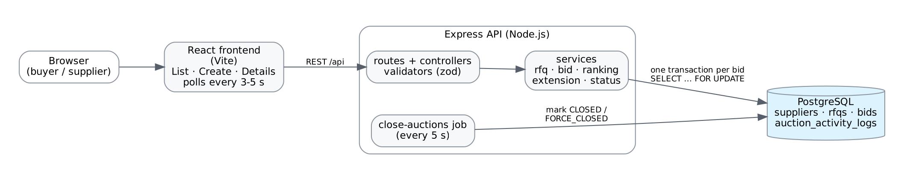

# British Auction RFQ

RFQ system with British auction (reverse auction) bidding. A buyer creates an RFQ, suppliers keep lowering their quotes, and if bidding happens close to the end the auction gets extended automatically. It never goes past the forced close time.

Stack: React (Vite) on the frontend, Node.js + Express + PostgreSQL on the backend.

Design docs:
- [docs/HLD.md](docs/HLD.md): architecture, how a bid is processed, how auctions close
- [docs/schema.md](docs/schema.md): tables and constraints



## Setup

You need Node.js 22+ and Docker (or your own PostgreSQL).

Start Postgres. The compose file runs it on port 15432 so it doesn't clash with a local install, and it creates the `rfq` and `rfq_test` databases.

```
docker compose up -d
```

Backend:

```
cd backend
cp .env.example .env
npm install
npm run migrate
npm run seed
npm run dev
```

The API runs on http://localhost:5000.

Frontend, in another terminal:

```
cd frontend
npm install
npm run dev
```

Then open http://localhost:5173.

If you use your own Postgres instead of Docker, create the `rfq` and `rfq_test` databases and update `DATABASE_URL` and `TEST_DATABASE_URL` in `backend/.env`.

### Environment variables

- `PORT`: API port, default 5000
- `DATABASE_URL`: main database
- `TEST_DATABASE_URL`: used by the tests (the tests wipe it)
- `APP_TIMEZONE`: used for the "quote validity can't be in the past" check, default Asia/Kolkata
- `CLOSE_JOB_INTERVAL_MS`: how often the job that closes finished auctions runs, default 5000

### Seed data

`npm run seed` resets the database and adds 4 suppliers and 3 RFQs:

- RFQ-DEMO-001 closes 3 minutes after seeding (X = 2 min, Y = 1 min, forced close at 6 min). It's useful for watching extensions happen. Run the seed again to reset it.
- RFQ-2026-002 is active and has a few bids.
- RFQ-2026-003 is already closed.

The New RFQ page also has a "Use test timings" link that fills in the same short times.

## Tests

```
cd backend
npm test
```

There are unit tests for the ranking, extension and status logic, API tests with Supertest against the test database, and one test that sends 30 bids at the same time to check the close time stays consistent. The test cases from section 14.1 of the assignment guide are all covered.

## API

```
POST /api/rfqs                 create an RFQ
GET  /api/rfqs                 list auctions
GET  /api/rfqs/:id             RFQ details and ranking
POST /api/rfqs/:id/bids        submit a bid
GET  /api/rfqs/:id/bids        ranking and all bids sorted by price
GET  /api/rfqs/:id/activity    activity log
GET  /api/suppliers            suppliers (used by the bid form)
```

Errors look like `{ "error": { "code": "AUCTION_CLOSED", "message": "..." } }`. Validation errors also include a `details` list with the field names.

## Assumptions

- A supplier can bid more than once. Each new total has to be lower than their own previous bid, but it doesn't have to beat L1.
- Total = freight + origin + destination. Suppliers are ranked on their lowest total. If two totals are equal, whoever bid first ranks higher.
- A bid counts as inside the trigger window if `close - X <= bid time < close`. A bid at exactly the close time is rejected.
- When the auction is extended, the new close is `min(current close + Y, forced close)`. It's based on the current close, not the time of the bid, same as the example in the assignment (6:00 to 6:05).
- After an extension the window moves too. It is always the last X minutes before the current close.
- The assignment guide asks whether a first bid counts as a rank change. I count it: a supplier's first bid adds a new row to the ranking, so it's a rank change, and the first bid on an RFQ makes someone L1, so it's an L1 change. Both are late moves other suppliers should get time to respond to. A supplier lowering their price without overtaking anyone does not count.
- X can't be longer than the auction itself, otherwise every bid would be a late bid.
- Status: Scheduled before the start, Active until the close, then Closed. It's Force Closed only if extensions pushed the close all the way to the forced close time. An auction that closed normally stays Closed.
- The server decides whether a bid is on time, using the database clock. Times are stored in UTC and shown in the browser's time zone.
- There's no login. The bid form has a supplier dropdown instead.
- Everyone can see all bids and prices, since the bidding is open.
- The frontend polls every few seconds instead of using WebSockets.

## Project structure

```
backend/
  migrations/   SQL schema
  scripts/      migrate and seed
  src/
    routes/  controllers/  services/  validators/  jobs/  middlewares/
  tests/
frontend/src/
  pages/  components/  api/  hooks/  utils/
docs/
```
