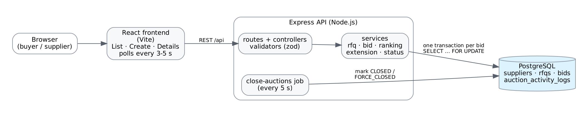

# High-Level Design

## Components

| Component | Responsibility |
|---|---|
| React frontend | Three pages: auction list, create RFQ, auction details. Polls the API (list every 5 s, details every 3 s). |
| Routes / controllers | Map URLs to services. Request bodies are validated with zod before they reach a service. |
| Services | All auction rules: ranking, the extension decision, status, and the bid transaction. |
| Close-auctions job | Runs every 5 s. Marks finished auctions `CLOSED` / `FORCE_CLOSED` and writes the closing entry to the activity log. |
| PostgreSQL | Stores RFQs, bids and the activity log. Constraints enforce the time rules, so bad data can't be saved even if the code has a bug. |

## How a bid flows through the system

1. `POST /api/rfqs/:id/bids` → body validated (charges ≥ 0, max 2 decimals, total > 0, …).
2. Transaction starts, and the RFQ row is locked with `SELECT … FOR UPDATE`.
3. The current time is read from the database **after** the lock is taken (`clock_timestamp()`).
4. Reject if the auction hasn't started or `now >= current_close_time`.
5. Reject if the supplier's new total isn't lower than their previous one.
6. Ranking **before** the bid → insert the bid → ranking **after** the bid.
7. If the bid is inside the trigger window and the RFQ's trigger condition is met, then
   `new close = min(current close + Y, forced close)`.
8. Write the activity log (the bid, plus the extension with its reason), then commit.

Because of the row lock, two bids on the same auction are handled one after another. The second bid always sees the close time the first one set, so two bids can never both extend from the same old close.

## Closing and status

Status is worked out from the clock every time an RFQ is read:

| Condition | Status |
|---|---|
| now < bid start | SCHEDULED |
| now < current close | ACTIVE |
| ended and current close = forced close | FORCE_CLOSED |
| ended otherwise | CLOSED |

So the API is correct even if the background job hasn't run yet. The job only keeps the stored `status` column in sync and adds the "auction closed" entry to the log.

## Key decisions

- **The server decides time, never the client.** Bid acceptance uses the database clock. The UI countdown is adjusted by the difference between the server time (sent with every response) and the browser clock.
- **Read the time after taking the lock.** `now()` in Postgres is the start of the transaction. A bid that waited for the lock could look earlier than it really was.
- **Extend from the current close, not from the bid time.** This matches the assignment example (6:00 → 6:05).
- **Money is `NUMERIC(12,2)`** in the database and compared as integer paise in code.
- **Polling instead of WebSockets.** It keeps the system simple, and 3 s is fast enough for a human watching an auction. WebSockets would be the next step.

## Scaling notes

- Running more API instances is safe. The row lock lives in Postgres, so bids are still serialized per auction.
- The close job uses `FOR UPDATE SKIP LOCKED`, so it can also run on every instance without double-closing an auction.
