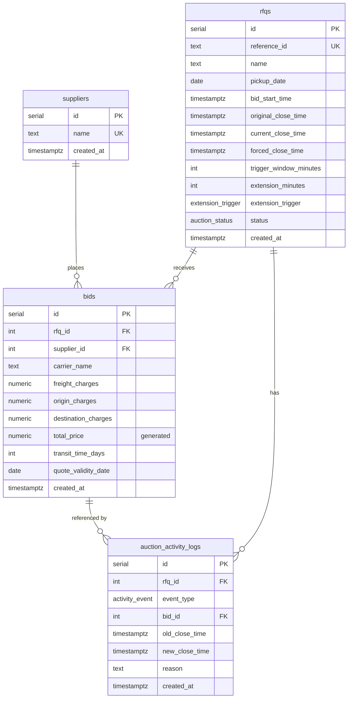

# Database Schema

Migration: [`backend/migrations/001_init.sql`](../backend/migrations/001_init.sql)

## Tables

### `suppliers`
The companies that bid. There's no login in this project, so the bid form picks a supplier from this table.

### `rfqs`
| Column | Notes |
|---|---|
| `reference_id` | Unique, e.g. `RFQ-2026-001` |
| `original_close_time` | Never changes. Kept so the UI can show how much the auction was extended. |
| `current_close_time` | Moves forward on each extension |
| `forced_close_time` | Hard limit. Never changes. |
| `trigger_window_minutes` / `extension_minutes` | X and Y, both > 0 |
| `extension_trigger` | `ANY_BID`, `ANY_RANK_CHANGE`, `L1_CHANGE` |
| `status` | `SCHEDULED`, `ACTIVE`, `CLOSED`, `FORCE_CLOSED`. Kept in sync by the close job; the API computes status from the clock. |

Constraints:
- `original_close_time > bid_start_time`
- `forced_close_time > original_close_time`
- `original_close_time <= current_close_time <= forced_close_time`. The last part is the "never extend past forced close" rule. It uses `<=` rather than `<`, because an auction extended right up to the cap has `current = forced`.

### `bids`
| Column | Notes |
|---|---|
| `freight_charges`, `origin_charges`, `destination_charges` | `NUMERIC(12,2)`, each ≥ 0 |
| `total_price` | Generated column (sum of the three), so it can never disagree with the charges. Must be > 0. |
| `created_at` | Set by the server inside the bid transaction, not by the client |

Bids are never updated. Every new price is a new row, so the history stays complete. `id` is serial, so it also gives the order bids were accepted, which is used to break ties ("whoever bid first keeps the rank").

### `auction_activity_logs`
One row per event: `RFQ_CREATED`, `BID_SUBMITTED`, `TIME_EXTENDED`, `AUCTION_CLOSED`, `AUCTION_FORCE_CLOSED`. Extensions store the old and new close time and a readable reason, e.g. *"L1 changed from BlueOcean Freight to FastShip Logistics within the last 2 minutes"*.

## Indexes

| Index | Used by |
|---|---|
| `bids (rfq_id, total_price, id)` | Lowest bid per RFQ on the listing page; ranked bid list |
| `bids (rfq_id, supplier_id)` | Loading a supplier's previous bids |
| `auction_activity_logs (rfq_id, created_at, id)` | Activity log in time order |
| `rfqs (status, current_close_time)` | The close job finding auctions that have ended |
